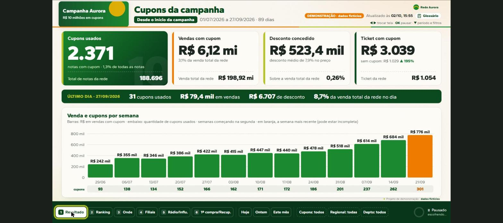
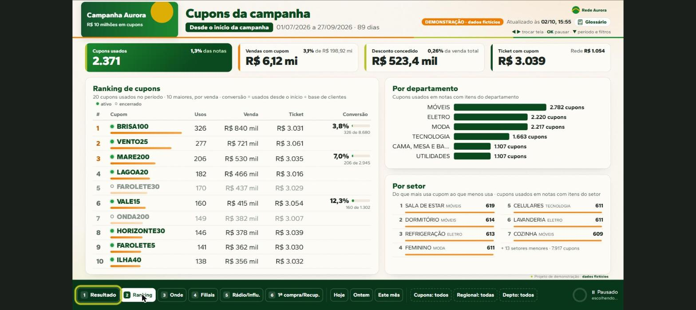
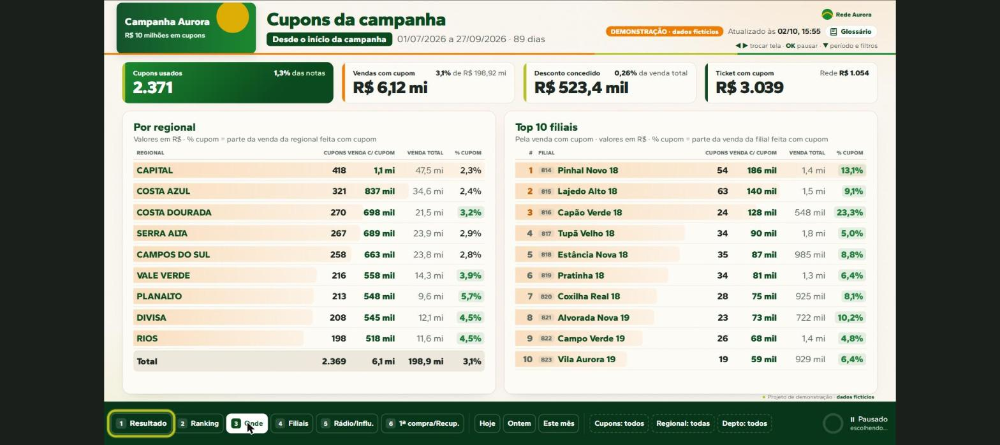
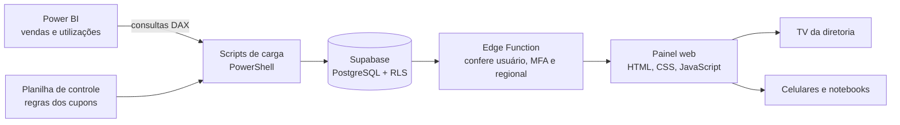

# Painel TV de Cupons

Painel web que mostra, em uma única tela, como está uma grande campanha de cupons de varejo. Roda na TV da diretoria e no celular e no notebook dos gestores, com dados que se atualizam a cada 30 minutos.

**[Ver a demonstração ao vivo](https://rodriguespedro22.github.io/painel-tv-cupons-demo/?demo=1)**



> **Versão de demonstração.** O sistema completo é de uso interno de uma empresa e fica em um repositório privado. Este repositório traz o front-end com **dados 100% fictícios** (marca "Rede Aurora", cupons, filiais e valores inventados), a arquitetura e as decisões técnicas.

## Por que o painel existe

A campanha criou vários cupons com regras diferentes: primeira compra, recuperação de clientes, rádio, influenciadores, CRM e outros. Sem uma visão única e atualizada, gerentes, coordenadores e diretoria teriam de consolidar planilhas e relatórios na mão.

O painel entrega:

- **Acompanhamento quase em tempo real.** Os números se atualizam a cada 30 minutos e ficam visíveis na TV e nos dispositivos dos gestores.
- **Medição do que funciona.** Taxa de conversão (utilizados ÷ disponibilizados) por grupo de cupom, como rádio e influenciadores, para apoiar decisões de mídia e de relacionamento com o cliente.
- **Vários cortes de leitura.** Ranking de cupons, departamento, setor, regional e filiais, com filtros de data, cupom, regional e departamento valendo em todas as telas.
- **Um dado só.** O uso dos cupons vem sempre do banco, nunca de planilha digitada. A planilha de controle traz apenas as regras (grupo, benefício, compra mínima, restrição, tipo).
- **Clareza para quem consulta.** Um glossário explica cada cupom em linguagem simples, em lista com busca.
- **Regras de negócio consistentes.** Filiais que não valem como loja e cupons que não devem aparecer ficam fora dos números.
- **Autonomia da equipe.** O time mantém a ferramenta sem depender de ajuste manual a cada cupom novo.

## Telas

| Ranking de cupons | Onde os cupons são usados |
| --- | --- |
|  |  |

Além dessas, o painel tem as telas **Filiais**, **Rádio/Influenciadores**, **Primeira compra/Recuperação**, **Glossário**, **Novidades** e uma área de **administração** (usuários, pedidos de acesso, regras de cupons e TVs).

## Arquitetura



| Camada | Tecnologia | Função |
| --- | --- | --- |
| Origem dos dados | Power BI | Vendas e utilizações de cupons |
| Regras dos cupons | Planilha no SharePoint | Grupo, benefício, compra mínima, restrição, tipo |
| Carga | PowerShell + consultas DAX | Atualização automática a cada 30 minutos, sem depender de uma máquina pessoal |
| Banco | Supabase (PostgreSQL) com Row Level Security | Vendas, cupons, usuários, pedidos de acesso e versões |
| Autenticação | Supabase Auth com e-mail, senha e MFA | Login próprio, com sessão diferente para as TVs |
| API | Edge Function | Os dados saem só por ela, que confere usuário, MFA, sessão e regionais |
| Front-end | HTML, CSS e JavaScript puros | Rotação de telas na TV, filtros, glossário, novidades e administração |
| Qualidade | Playwright, ESLint, Stylelint, GitHub Actions | Testes de tela e verificação em cada alteração |
| Hospedagem | Netlify | Publicação do painel |

## Decisões que valem destacar

- **Segurança no banco, não só na tela.** As políticas de acesso por linha (RLS) garantem que cada pessoa só enxergue as regionais liberadas para ela.
- **Acesso por aprovação.** Quem precisa de acesso pede pelo próprio painel, um administrador aprova e define o que a pessoa vê.
- **Modo demonstração.** O painel roda com dados fictícios (`?demo=1`), o que permite testar as telas automaticamente sem tocar em dado real.
- **Sem etapa de build.** O front-end é estático: a pasta `site/` é publicada como está, com cabeçalhos de segurança e CSP restritiva.
- **Rotina de entrega.** Cada mudança passa por lint e por testes de tela antes de ir ao ar, e o histórico de versões fica visível dentro do painel.

## Minha parte

Projetei e construí o painel de ponta a ponta: modelagem do banco e das políticas de acesso, carga a partir do Power BI, função de API, autenticação com MFA, telas, testes automatizados e publicação.

## Como rodar a demonstração

Precisa do Node.js 20 ou mais novo.

```bash
npm run dev
```

Abra http://localhost:8811/?demo=1. A área de administração fica em `/admin.html?demo=1`.

## Tecnologias

Supabase · PostgreSQL · Row Level Security · Edge Functions · Power BI (DAX) · PowerShell · JavaScript · Playwright · GitHub Actions · Netlify

## Licença

Código publicado para visualização e avaliação de portfólio. Todos os direitos reservados.

## Contato

Pedro Rodrigues da Cunha · [LinkedIn](https://www.linkedin.com/in/pedrorodrigues2) · [GitHub](https://github.com/rodriguespedro22)
